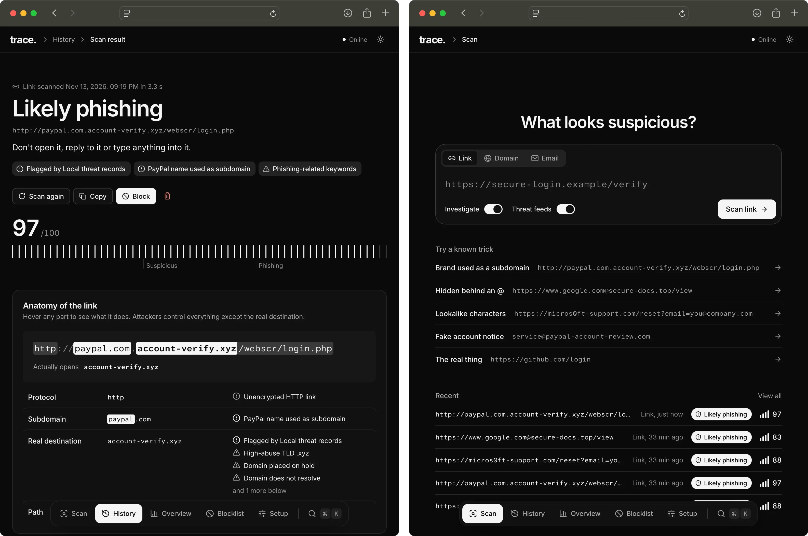

# trace.

Trace helps you check if a link, a domain or an email is a phishing attempt. Paste something suspicious and Trace takes it apart. It shows you what looks wrong, where it really leads, and why it got its score.


<!-- Replace docs/images/result.png with a screenshot of a scan result -->

## What it does

- **Checks links.** It looks for tricks like lookalike spellings, brand names hidden in subdomains and `@` tricks. It also follows redirects and looks at the page it lands on.
- **Checks domains.** It looks up how old the domain is, its DNS records and its certificate.
- **Checks emails.** Paste a full message or upload an `.eml` file. Trace checks the sender, SPF, DKIM and DMARC results, the wording, the links and the attachments.
- **Explains every score.** You get a 0–100 risk score. Every point of it comes from a finding you can read.
- **Uses a model for a second opinion.** A trained model scores the link and shows which parts of it mattered most.
- **Checks known threats.** It uses your own blocklist. It can also use VirusTotal, Google Safe Browsing, URLhaus and PhishTank if you add their keys.
- **Keeps a history.** Every scan is saved on your computer.

# Built with

- **Frontend:** React, TypeScript and Vite
- **Backend:** Python and FastAPI
- **Storage:** SQLite
- **Detection:** scikit-learn and XGBoost

## Getting started

You need:

- Node.js 20.19 or newer
- Python 3.12 or newer
- On a Mac: `brew install libomp` (XGBoost needs it)

Then open the project folder in a terminal and run:

```bash
npm run dev
```

That one command does everything. The first run installs the packages and trains the model, so give it a minute or two. After that it starts in seconds. Open the address it prints, usually http://localhost:47613.

## Using Trace

1. Paste a link, a domain or an email on the Scan page. Press ⌘K (Ctrl+K on Windows) to scan from any page.
2. Read the result. Hover over parts of a link to see what each one does.
3. Block anything bad. It goes on your blocklist, and any future scan that matches it is marked as phishing.

## Optional setup

Trace works without any setup. To add threat feed keys, copy the example file and fill in what you have:

```bash
cp .env.example .env
```

The `.env.example` file lists every setting.

## Other commands

| Command | What it does |
| --- | --- |
| `npm test` | Runs the backend tests |
| `npm run build` | Builds the web app |

## A note on accuracy

The model that comes with Trace learned from generated examples, so treat its score as a helpful hint, not proof. You can train it on real data with `python -m app.ml.train --csv urls.csv` from the `backend` folder. The CSV needs `url` and `label` columns.

## Project layout

```
backend/    API, scan logic and the model
frontend/   The web app
scripts/    The dev script behind npm run dev
```